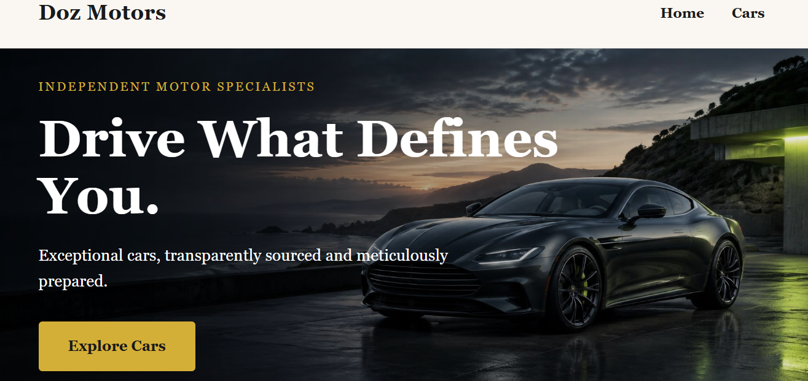

# Doz Motors 🚗

A premium car dealership website built from scratch with vanilla HTML, CSS, and JavaScript.

## 🔗 Live Demo

[View the live site](https://akujobidaniel.netlify.app/dozmotors/)

## 📖 Overview

Doz Motors is a concept car dealership project built to practice real front-end development. The goal was to go beyond static layouts by implementing a dynamic product grid with JavaScript-driven filtering, without relying on any frameworks or libraries.

## ✨ Key Features

- **Filterable car listings** — users can instantly sort vehicles by category (All, Sports, SUV, Saloon, Electric) without a page reload
- **Multi-page architecture** — a home page with a hero and featured cars, plus a full listings page
- **Trust section** — a dedicated area highlighting the inspection and warranty process
- **Responsive design** — optimized for both desktop and mobile

## 🛠️ Tech Stack

- **HTML5** — semantic structure
- **CSS3** — layout, styling, and responsive design
- **JavaScript (ES6)** — DOM manipulation and filtering logic

## 🧠 How the Filtering Logic Works

Each car card carries a hidden `data-category` attribute (e.g. `data-category="suv"`), and each filter button carries a matching category label. When a button is clicked, JavaScript compares the two:

- If the labels match (or if "All" is selected), the card stays visible.
- Otherwise, the card is hidden using CSS classes.

This approach keeps the HTML clean and the JavaScript logic reusable. Working with `data-*` attributes was also a useful look at the pattern that modern frameworks use under the hood for binding data to elements.

## 🖼️ Project Images

Car photography is a mix of stock imagery and AI-generated images, chosen to maintain a consistent visual treatment across categories where real photography wasn't available for every vehicle type.

## 📁 Project Structure
